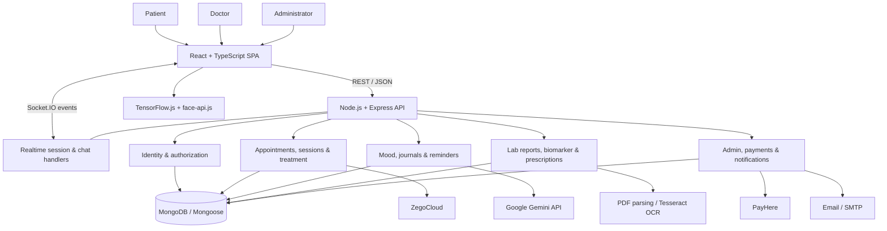

<div align="center">

# 🩺 Medi-Link

### AI-Assisted Healthcare & Wellness Management Platform

**A full-stack, team-developed platform bringing together patient care workflows, appointments, virtual consultations, wellness tracking, and AI-assisted document analysis.**


[**Explore integrated source**](https://github.com/buddhimabg/Medi-Link/tree/integration2) · [**Features**](#features) · [**Architecture**](#architecture) · [**Quick start**](#quick-start) · [**API reference**](#api-reference) · [**Contributors**](#team-and-contributions)

</div>

---

## Overview

**Medi-Link** is a collaborative healthcare and wellness web application with separate patient, doctor, and administrator experiences. It combines traditional healthcare workflows—such as appointment booking, treatment plans, messaging, consultations, and prescription management—with wellness features including mood check-ins, activity recommendations, reminders, and report analysis.

The application uses a **React + TypeScript** single-page frontend, a **Node.js + Express** REST backend, **MongoDB** with Mongoose models, and **Socket.IO** for live communication events. Additional integrations support generative-AI assistance, document parsing, payments, email, and video consultations.

> **Scope and safety:** Medi-Link is an educational software engineering project. Its AI-based text analysis, inferred emotional indicators, numerical wellness scores, and lab-report interpretations are demonstration features, **not medical diagnoses or clinical advice**. They require human verification and appropriate privacy safeguards before use with real patient data.

## Features

### 🧑‍⚕️ Patient, doctor, and admin workflows

- **Accounts and identity:** Patient registration and login, Google sign-in integration, password-reset flow, JWT-based access mechanisms, and role-specific experiences.
- **Appointments:** Doctor discovery, appointment booking, rescheduling/cancellation, appointment history, payment status, and invoice support.
- **Doctor workspace:** Patient lists, schedules, session management, treatment plans, progress notes, and consultation workflows.
- **Virtual consultations:** Video session creation/joining, invitation flows, consultation notes, recording/transcript-related modules, and Socket.IO session events.
- **Messaging:** Patient–doctor conversations, real-time chat events, typing notifications, chatbot-related features, and message history.
- **Administration:** Doctor and patient management, session oversight, payment/report views, notification sending, and operational dashboards.

### 🌿 Mood tracking and AI-assisted wellness

- **Daily check-ins:** A multi-step mood entry flow that collects mood and related wellbeing factors.
- **Wellness dashboard:** Historical entries, seven-day averages, check-in streaks, calculated scores, trends, and insight visualizations.
- **Mood-support activities:** Suggested self-care activities and a mood-focused activity log.
- **Journal and speech analysis:** Google Gemini integration for journal text and supported audio uploads, returning structured AI-generated observations and suggestions.
- **Browser-based expression estimation:** TensorFlow.js and face-api.js for facial-expression signals in the client UI.
- **Assessment and content modules:** Wellness assessments, journal views, and educational/self-care content.

### ⏰ Reminders and document analysis

- **Flexible reminders:** One-time, daily, weekly, and date-specific schedules; create, edit, delete, snooze/disable-date behaviors, and browser notification UI.
- **Prescription-assisted reminders:** Upload supported PDF/images for AI-assisted extraction into reviewable reminders.
- **Lab report ingestion:** PDF uploads with `pdf-parse` and Tesseract.js OCR processing paths.
- **Biomarker interpretation:** Label/measurement extraction, unit normalization, reference-range comparisons, and calculated display scores.
- **Report history:** Saved report listings and detailed report views in the patient frontend.

> Features are documented from application routes, UI pages, controllers, services, and dependency manifests in `integration2`. Their presence in source code does not guarantee every external integration works without credentials or configuration.

## Technology stack

| Area | Implemented technologies |
| --- | --- |
| **Frontend** | React 19, TypeScript, Vite 7, Tailwind CSS, React Router |
| **Client state and requests** | Zustand, Axios, Fetch API |
| **Analytics and UI** | Chart.js, React Chart.js 2, Recharts, Lucide React |
| **Backend** | Node.js, Express 5, REST APIs |
| **Data layer** | MongoDB, Mongoose |
| **Authentication and validation** | JSON Web Tokens (JWT), Google OAuth integration, bcryptjs, express-validator |
| **Realtime and communication** | Socket.IO, Socket.IO Client, Nodemailer |
| **AI and computer vision** | Google Gemini API, TensorFlow.js, face-api.js |
| **Document processing** | pdf-parse, Tesseract.js, Multer, PDFKit, jsPDF |
| **Scheduling** | node-cron and reminder scheduling logic |
| **Third-party integrations** | ZegoCloud (consultations), PayHere (payment workflows) |
| **Testing and build tools** | Node.js assertion-based tests, Selenium WebDriver, Chrome, ESLint, TypeScript compiler, Vite |

**Implementation evidence:** [Backend dependencies](https://github.com/buddhimabg/Medi-Link/blob/integration2/backend/package.json) · [Frontend dependencies](https://github.com/buddhimabg/Medi-Link/blob/integration2/web%20frontend/package.json) · [Selenium dependencies](https://github.com/buddhimabg/Medi-Link/blob/integration2/selenium_tests/package.json)

## Architecture

Medi-Link is a **client–server, modular application**, not a collection of independently deployed microservices. The Express process mounts domain-specific API routers and hosts Socket.IO; the frontend consumes APIs and renders role-oriented workflows.



### Main execution flow

1. A patient, doctor, or administrator opens the React application.
2. Frontend pages and API clients call the corresponding Express router over HTTP.
3. Controllers delegate to services and Mongoose models for application data and business logic.
4. Features that require them call external AI, payment, video, or email providers.
5. Chat/session components exchange real-time events through the Socket.IO server.
6. The frontend displays responses, loading/error states, and feature-specific visualizations.

This is a conceptual architecture diagram of the implemented modules, not a claim of a separate production cloud topology.

## Repository structure

```text
Medi-Link/
├── package.json                  # Root install/dev/build helpers
├── backend/
│   ├── server.js                 # Express + Socket.IO startup and route mounting
│   ├── config/db.js              # Mongoose connection
│   ├── controllers/              # HTTP controllers by domain
│   ├── routes/                   # Auth, mood, reports, reminders, consultations, etc.
│   ├── services/
│   │   ├── ai/                   # Gemini analysis and AI service helpers
│   │   ├── moodService.js        # Mood history, statistics and insights
│   │   └── labReportAnalysisService.js
│   ├── models/                   # MongoDB schemas
│   ├── middlewares/              # Authentication, validation and upload handling
│   ├── utils/                    # Error, scoring, insights and helper functions
│   ├── tests/                    # Lab report analysis unit tests
│   ├── .env.example              # Names of backend environment variables
│   └── package.json
├── web frontend/
│   ├── src/
│   │   ├── api/                  # Typed API clients and request helpers
│   │   ├── components/           # Shared UI, reminders, dialogs and layouts
│   │   ├── hooks/                # Mood, AI and reminder hooks
│   │   ├── pages/                # Patient, doctor, admin and wellness pages
│   │   ├── config/               # Frontend API configuration
│   │   └── App.tsx               # Client routing
│   ├── .env.example
│   └── package.json
└── selenium_tests/
    ├── modules/
    │   ├── moodTracking.test.js
    │   ├── reminders.test.js
    │   └── reportAnalysis.test.js
    ├── helpers/                  # Chrome WebDriver helpers and test fixtures
    ├── runAllTests.js
    └── package.json
```

## Quick start

### Requirements

- **Node.js 22 LTS** with npm (a practical choice for this Vite 7-based project)
- **MongoDB** running locally or a MongoDB connection URI you control
- **Git**
- **Google Chrome** if you want to run Selenium browser tests
- Credentials for optional integrations (Gemini, ZegoCloud, PayHere, email, Google sign-in) only when testing those workflows

The commands below use **PowerShell on Windows**. They do not require Docker or any unverified deployment service.

### 1. Clone the integrated branch

```powershell
git clone --branch integration2 https://github.com/buddhimabg/Medi-Link.git
cd Medi-Link
```

The team's integrated code is in `integration2`. The repository's default `main` branch may not yet contain all these features.

### 2. Install the dependencies

From the project root:

```powershell
npm run install:all
```

The root `install:all` script installs packages for the root workspace, `backend`, and `web frontend`. Selenium tests have their own installation step below.

### 3. Configure the backend

```powershell
Copy-Item backend/.env.example backend/.env
```

Edit `backend/.env` locally. For a basic local database connection, set these entries:

```dotenv
PORT=5000
MONGO_URI=mongodb://127.0.0.1:27017/medilink
```

For authentication flows, set `JWT_SECRET` to a **strong, unique, locally generated secret**. For AI, video, payments, or email, supply the credentials for the specific integrations you plan to exercise. Never commit a real `.env` file.

### 4. Configure the frontend

```powershell
Copy-Item "web frontend/.env.example" "web frontend/.env"
```

Use these local development endpoints in `web frontend/.env`:

```dotenv
VITE_MEDITRACK_API_URL=http://localhost:5000
VITE_API_BASE_URL=http://localhost:5000/api/admin
```

The second value points the administrator API client at the server's `/api/admin` prefix. Frontend environment variables beginning with `VITE_` are embedded in the browser build: **never store API secrets in them**.

### 5. Start the application

From the repository root:

```powershell
npm run dev
```

The root command starts both dev processes using `concurrently`:

| Component | Local address | Script |
| --- | --- | --- |
| Backend | `http://localhost:5000` | `npm run dev:backend` |
| Frontend | `http://localhost:5175` | `npm run dev:frontend` |
| Backend health endpoint | `http://localhost:5000/health` | Express health route |

Open `http://localhost:5175` after both processes start. The backend must be able to connect to MongoDB. On first startup, the server also checks/seeds default mood-fix activities and biomarker definitions.

### 6. Verify the basic service

In a separate terminal:

```powershell
Invoke-RestMethod http://localhost:5000/health
```

The health route is coded to return `success: true` with `status: "ok"`. This endpoint only confirms the process is responding; it is **not** proof that every third-party integration is configured.

## Environment variable reference

The backend template is [`backend/.env.example`](https://github.com/buddhimabg/Medi-Link/blob/integration2/backend/.env.example). It currently defines:

| Variable | Usage |
| --- | --- |
| `PORT` | Express server port (local setup above: `5000`) |
| `MONGO_URI` | MongoDB connection string |
| `JWT_SECRET` | Signing/verification key for JWT-based routes |
| `GEMINI_API_KEY` | Gemini-assisted journal, speech, and other AI features |
| `ZEGO_APP_ID`, `ZEGO_SERVER_SECRET` | ZegoCloud video-session integration |
| `PAYHERE_MERCHANT_ID`, `PAYHERE_MERCHANT_SECRET` | Payment integration configuration |
| `SMTP_HOST`, `SMTP_PORT`, `SMTP_USER`, `SMTP_PASS`, `SMTP_FROM` | Outbound email configuration |
| `MAX_FILE_SIZE` | Admin upload-size configuration |

The frontend template is [`web frontend/.env.example`](https://github.com/buddhimabg/Medi-Link/blob/integration2/web%20frontend/.env.example):

| Variable | Usage |
| --- | --- |
| `VITE_MEDITRACK_API_URL` | Base URL for mood, reminder, report, and authentication API clients |
| `VITE_API_BASE_URL` | Base URL for the admin API client; use the server's `/api/admin` prefix locally |

The app may require additional setup for individual integration providers. The basic local boot procedure above is independent of those provider credentials, but their features will not function until configured.

## API reference

All route groups below are mounted in [`backend/server.js`](https://github.com/buddhimabg/Medi-Link/blob/integration2/backend/server.js). The examples are **endpoint paths from source code**, not a hosted public API. Authorization, required request fields, and response schemas should be taken from the linked route/controller files.

### Representative endpoints

| Method | Path | Purpose |
| --- | --- | --- |
| `GET` | `/health` | Server health response |
| `POST` | `/api/auth/register` | Patient registration |
| `POST` | `/api/auth/login` | Email/password login |
| `POST` | `/api/auth/google` | Google login integration |
| `POST` | `/api/moods` | Record a mood check-in |
| `GET` | `/api/moods/dashboard/:userId` | Dashboard statistics |
| `GET` | `/api/moods/history/:userId` | Mood history |
| `GET` | `/api/moods/insights/:userId` | Mood insights |
| `GET` | `/api/reminders` | Retrieve reminders |
| `POST` | `/api/reminders` | Create a reminder |
| `PATCH` | `/api/reminders/:id` | Update a reminder |
| `DELETE` | `/api/reminders/:id` | Remove a reminder |
| `POST` | `/api/reminders/upload-prescription` | Analyze an uploaded prescription for reminder creation |
| `POST` | `/api/ai/analyze-journal` | Analyze journal text |
| `POST` | `/api/ai/analyze-speech` | Analyze uploaded speech/audio |
| `POST` | `/api/ai/analyze-camera` | Process camera-analysis input |
| `POST` | `/api/ai/analyze-combined` | Combine AI-related signals |
| `POST` | `/api/lab-reports/upload` | Upload a PDF lab report (form field `report`) |
| `GET` | `/api/lab-reports/user/:userId` | Retrieve user report history |
| `GET` | `/api/lab-reports/:reportId` | Retrieve report details |
| `POST` | `/api/appointments` | Create an appointment |
| `GET` | `/api/appointments` | List appointments |
| `GET` | `/api/assessments/latest/:userId` | Latest assessment |

### Additional route groups

The server also mounts API modules under:

`/api/doctors`, `/api/mood-fix`, `/api/biomarkers`, `/api/wellness`, `/api/notifications`, `/api/payments`, `/api/video`, `/api/prescriptions`, `/api/patient-history`, `/api/chat`, `/api/journals`, `/api/slots`, `/api/patients`, `/api/doctor`, `/api/treatment-plans`, `/api/sessions`, and `/api/admin/*`.

- [Mood router](https://github.com/buddhimabg/Medi-Link/blob/integration2/backend/routes/moodRoutes.js)
- [Reminder router](https://github.com/buddhimabg/Medi-Link/blob/integration2/backend/routes/reminderRoutes.js)
- [AI router](https://github.com/buddhimabg/Medi-Link/blob/integration2/backend/routes/aiRoutes.js)
- [Lab report router](https://github.com/buddhimabg/Medi-Link/blob/integration2/backend/routes/labReportRoutes.js)
- [Appointment router](https://github.com/buddhimabg/Medi-Link/blob/integration2/backend/routes/appointmentRoutes.js)
- [Video-session router](https://github.com/buddhimabg/Medi-Link/blob/integration2/backend/routes/videoRoutes.js)

## Testing and quality checks

Automated tests are organized at two levels: **Node.js module/unit tests** and **Selenium browser UI tests**.

### Backend module tests

From the project root, after installing dependencies:

```powershell
npm --prefix backend test
```

The backend's `test` script invokes:

- `tests/labReportAnalysis.test.js` — report parsing, biomarker unit/range handling, and score calculations.
- `utils/scoreEngine.test.js` — mood/recovery scoring, boundary handling, and insight consistency.

### Frontend build and lint

```powershell
npm run build:frontend
npm --prefix "web frontend" run lint
```

Build uses the TypeScript compiler and Vite. Lint uses ESLint. These commands are checks to **run**, not claims that this README author has executed them successfully on your environment.

### Selenium UI tests

1. Start the frontend and backend as described in **Quick start**.
2. Ensure Google Chrome is installed and use synthetic test data.
3. In a separate **PowerShell** terminal:

```powershell
cd selenium_tests
npm install
$env:BASE_URL = "http://localhost:5175"
npm test
```

**Important:** The Selenium driver helper defaults to `http://localhost:5173`, while this repository's Vite script runs on **5175**. Setting `BASE_URL` prevents tests from targeting the wrong port.

The suite groups browser flows into these modules:

| Test module | Main scenarios covered |
| --- | --- |
| `moodTracking.test.js` | Check-in steps, history, insights, dashboard statistics, mood-fix pages |
| `reminders.test.js` | Reminder list, create/update/delete flows and related UI behavior |
| `reportAnalysis.test.js` | Report page, PDF upload, extracted values, status display, score and recommendation sections |

The runner reports individual test results and passed/failed counts. Do not represent tests as passing until you've run the suite against the target branch and configuration.

## Engineering notes

- **Layered API structure:** Routes, controllers, services, Mongoose models, and shared utilities support domain-specific development.
- **State and API handling:** Zustand manages client state in selected modules; Axios/API wrappers normalize request, timeout, validation, and network errors.
- **Service-level processing:** Mood scoring, insights, AI adapters, reminder scheduling, and report analysis use dedicated files rather than keeping all logic inside React pages.
- **Realtime flow:** Socket.IO handles session rooms, chat rooms, join/typing events, and media state notifications.
- **Verification:** The repository includes test modules for report processing and scoring, plus Selenium UI suites for three major wellness modules.
- **Team integration:** The `integration2` branch brings together feature branches from multiple team members and preserves their Git commit history.


## Team and contributions

Medi-Link is a **group project**. The integrated Git history records commits from several team members, including:

| GitHub contributor | Repository evidence |
| --- | --- |
| **[senu003 — Senuji Sulakma](https://github.com/senu003)** | [Development branch](https://github.com/buddhimabg/Medi-Link/tree/dev-senuji) · [Commits on integration2](https://github.com/buddhimabg/Medi-Link/commits/integration2/?author=senu003) |
| [buddhimabg](https://github.com/buddhimabg) | [Repository and integration history](https://github.com/buddhimabg/Medi-Link/commits/integration2/) |
| [madushikadilshari0121](https://github.com/madushikadilshari0121) | [Integrated commit history](https://github.com/buddhimabg/Medi-Link/commits/integration2/) |
| [Pavindu11](https://github.com/Pavindu11) | [Integrated commit history](https://github.com/buddhimabg/Medi-Link/commits/integration2/) |
| [hiru20010816](https://github.com/hiru20010816) | [Integrated commit history](https://github.com/buddhimabg/Medi-Link/commits/integration2/) |


## Project status and source

The integrated implementation documented here is on **[`integration2`](https://github.com/buddhimabg/Medi-Link/tree/integration2)**. The repository's default branch is [`main`](https://github.com/buddhimabg/Medi-Link/tree/main), which may display an earlier snapshot until the team completes its reviewed merge. Follow the integrated branch to inspect the features and tests described above.

No live deployment URL or build-success badge is listed here because neither has been established as a verified public project endpoint or CI result. The repository remains the authoritative source for the actual implementation.

---

<div align="center">

**Medi-Link — built collaboratively, documented transparently.**

[GitHub repository](https://github.com/buddhimabg/Medi-Link) · [Integrated source](https://github.com/buddhimabg/Medi-Link/tree/integration2) · [Commit history](https://github.com/buddhimabg/Medi-Link/commits/integration2/)

</div>
